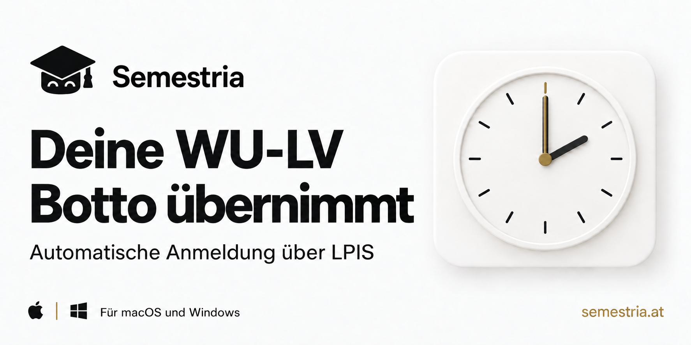
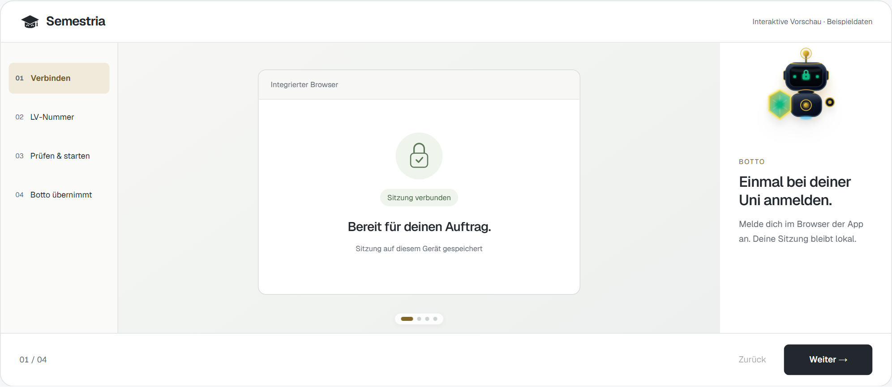
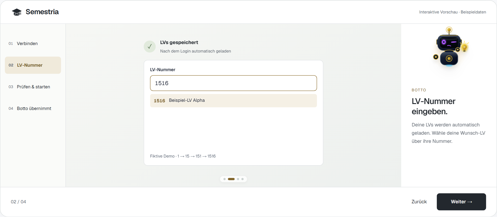
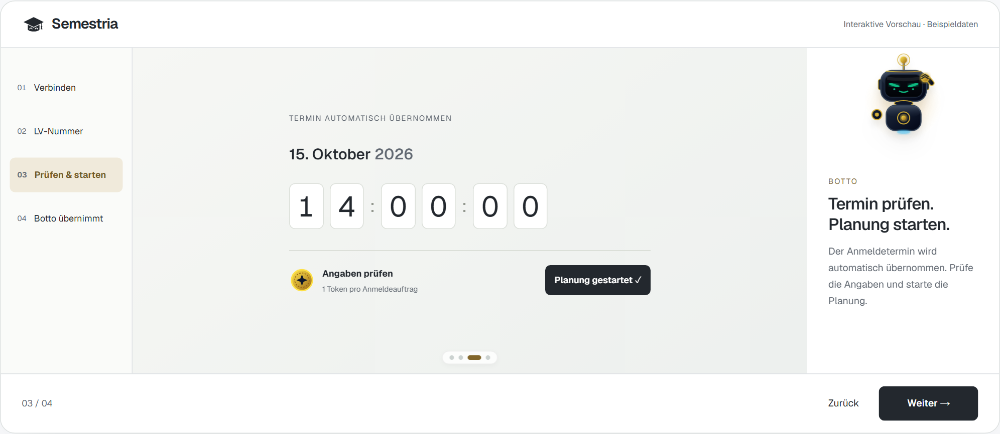
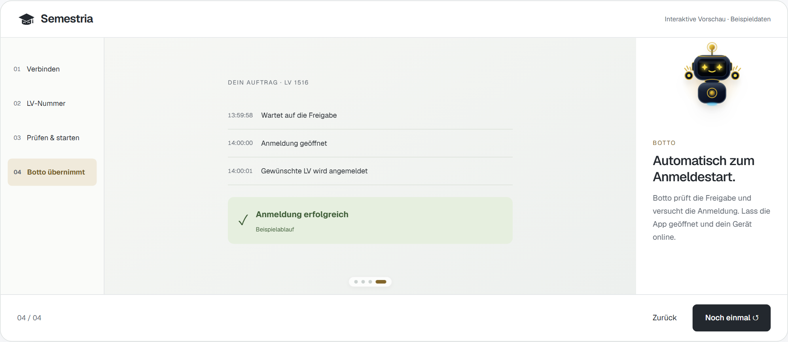
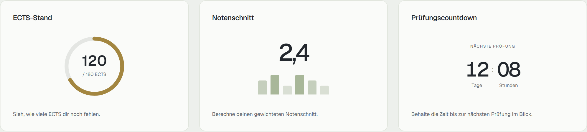

# Semestria: LPIS bot for WU Vienna

**Prepare your WU course registration. Let Botto take over.**

Semestria is a desktop app for automatic course registration in LPIS at WU Vienna, available for **macOS and Windows**. Select a supported course in advance and let Botto perform the registration attempt when registration opens.

**[Download Semestria](https://semestria.at/downloads-en)** · [Help center](https://semestria.at/faq-en) · [Deutsch](README.md)

Official product information for [Semestria at semestria.at](https://semestria.at/en), provided by Semestria e.U.

## Walkthrough

The images below show the existing German-language product demo with sample data. They explain the workflow; the interface may differ by app version.

### 1. Install Semestria

Choose the macOS or Windows installer on the [official download page](https://semestria.at/downloads-en). It lists current versions and system requirements. Open the app and sign in to your Semestria account. Your app account is separate from the university login in the next step.

### 2. Connect to WU/LPIS

Open the university login in the app's integrated browser and sign in to WU. Semestria can then load supported courses. Your university session stays on your device.

### 3. Select your course

Enter the course number and select the matching course from the loaded results. Check that it is the course you want. The demo uses fictional course 1516.

### 4. Check the time and prepare the task

Check the registration date and time supplied for the supported course, review the task details and start planning in the app.

### 5. Let Botto take over

Keep Semestria open and your computer awake and online. Botto waits for registration to open and performs the registration attempt. Follow the progress in the app.

The green confirmation is a simulated example, not evidence of an actual registration or a guaranteed success rate.

### 6. Check the result

Review the feedback in Semestria and your registration status in LPIS. For questions or unexpected results, visit the [help center](https://semestria.at/faq-en).

## Free study tools

Track your ECTS progress, calculate your grade average and keep exams in view with the countdown.

Preparation and study tools are free. Starting an automatic registration task requires a token. Current conditions are shown in the app.

## Which Semestria app is this?

This is Semestria e.U.'s WU-LPIS desktop app at **semestria.at**, available for macOS and Windows. Automatic course registration currently supports WU Vienna through LPIS. Check course support in the app.

Semestria is independently developed. Registration attempts operate within available places and your course eligibility requirements.

## About this repository

This repository contains official product information and images. Install the desktop app from the [website](https://semestria.at/downloads-en); the app source code is not included here.

[Help center](https://semestria.at/faq-en) · [Contact](https://semestria.at/contact)

Do not post LPIS credentials or personal session data in public issues.
