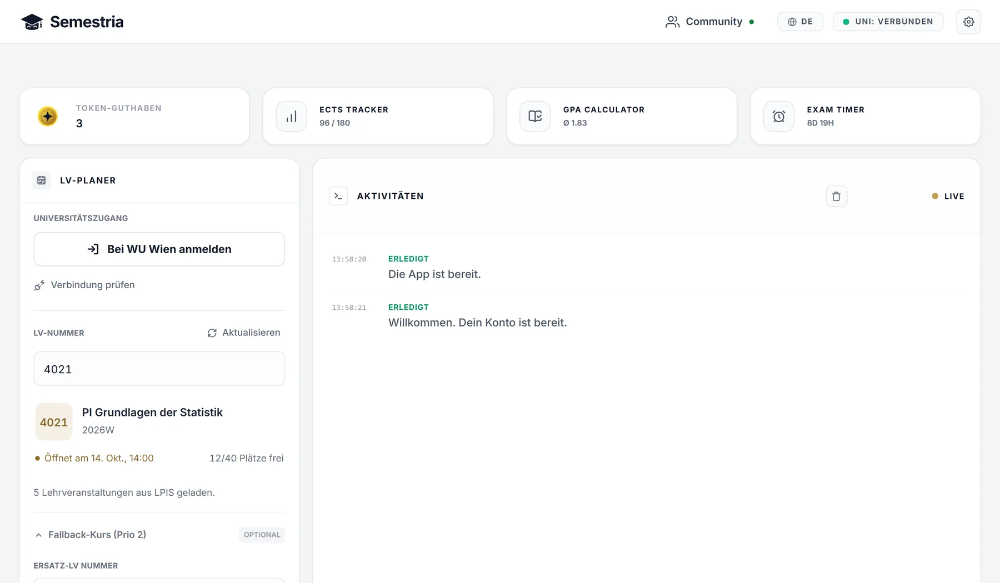

# Semestria: LPIS Bot für die WU Wien

**Deine WU-LV. Botto übernimmt.**

Semestria ist eine Desktop-App für die automatische LV-Anmeldung über LPIS an der WU Wien, verfügbar für **macOS und Windows**. Du wählst deine unterstützte Lehrveranstaltung vorab. Botto übernimmt zum Anmeldestart die Bedienung auf deinem Computer.

**[Semestria herunterladen](https://semestria.at/downloads)** · [Walkthrough](#walkthrough-von-der-installation-bis-zum-anmeldestart) · [Hilfe](https://semestria.at/faq) · [English](README.en.md)

Offizielle Produktinformationen zu [Semestria auf semestria.at](https://semestria.at/). Anbieter: Semestria e.U.

## Walkthrough: von der Installation bis zum Anmeldestart

Die vier Ablaufbilder stammen aus der interaktiven Semestria-Produktdemo. Sie zeigen Beispieldaten und erklären die Schritte. Die Oberfläche kann je nach App-Version abweichen.

### 1. Semestria installieren

Lade den passenden Installer von der [offiziellen Downloadseite](https://semestria.at/downloads) herunter und installiere die App. Dort stehen die aktuellen Versionen und Systemvoraussetzungen.

| Dein Computer | Einstieg |
| --- | --- |
| Mac mit Apple Silicon oder Intel | macOS-Download auf semestria.at auswählen |
| Windows-PC | Windows-Download auf semestria.at auswählen |

Öffne Semestria und melde dich mit deinem Semestria-Konto an. Das ist vom anschließenden Login bei deiner Universität getrennt.

### 2. Mit WU/LPIS verbinden

Öffne den Uni-Login im Browser der App und melde dich bei der WU an. Damit kann Semestria deine unterstützten Lehrveranstaltungen laden. Deine Uni-Sitzung bleibt auf deinem Gerät.

### 3. Deine Lehrveranstaltung auswählen

Gib die LV-Nummer ein und wähle den passenden Eintrag aus den geladenen Lehrveranstaltungen. Prüfe, ob es wirklich deine gewünschte LV ist. Im Beispiel wird die fiktive LV 1516 ausgewählt.

### 4. Termin prüfen und Auftrag vorbereiten

Der Anmeldetermin wird für die unterstützte LV übernommen. Kontrolliere Datum und Uhrzeit sowie die Angaben zum Auftrag. Starte anschließend die Planung in der App.

### 5. Botto zum Anmeldestart übernehmen lassen

Lass Semestria geöffnet und deinen Computer wach und online. Botto wartet auf den Anmeldestart und führt dann den automatischen Anmeldeversuch aus. Du kannst den Verlauf in der App verfolgen.

*Die grüne Bestätigung im Bild ist ein simulierter Beispielablauf. Sie ist kein Beleg für eine tatsächlich erfolgte Anmeldung oder eine garantierte Erfolgsquote.*

### 6. Ergebnis prüfen

Prüfe die Rückmeldung in Semestria und deinen Anmeldestatus in LPIS. Wenn etwas nicht wie erwartet funktioniert, findest du im [Hilfe-Center](https://semestria.at/faq) die nächsten Schritte und den Kontakt zum Support.

Die App-Oberfläche im Überblick

Produktansicht aus der Semestria-Website. Oberfläche und Beispiele können je nach App-Version abweichen.

## Anmeldung und Studium in einer App

- Eine WU-LV-Anmeldung vor dem Anmeldestart vorbereiten.
- Die Bedienung zum Startzeitpunkt automatisch ausführen lassen.
- Deinen ECTS-Stand und Notendurchschnitt berechnen.
- Mit dem Prüfungs-Countdown wichtige Termine im Blick behalten.

*Illustrative Ansichten mit Beispieldaten.*

Vorbereitung und Studienwerkzeuge sind kostenlos. Zum Start eines automatischen Anmeldeauftrags benötigst du einen Token. Die aktuellen Konditionen findest du in der App.

## Fragen zu Semestria und LPIS

### Gibt es Semestria für Mac und Windows?

Semestria gibt es für **macOS und Windows**. Aktuelle Installer, Versionen und Systemvoraussetzungen stehen auf der [Downloadseite](https://semestria.at/downloads).

### Welche Universität unterstützt die automatische Anmeldung?

Die automatische Anmeldung unterstützt aktuell die **WU Wien über LPIS**. Ob deine Lehrveranstaltung unterstützt wird, prüfst du in der App.

### Muss ich zur Anmeldung am Computer sitzen?

Du bereitest den Auftrag vor. Zum Anmeldestart übernimmt Botto die Bedienung. Semestria bleibt geöffnet, dein Computer wach und online.

### Welche Semestria-App wird hier beschrieben?

Diese Seite beschreibt die WU-LPIS-App von **Semestria e.U. auf semestria.at**. Download, Hilfe und Kontakt für dieses Produkt stehen auf dieser Website.

Semestria ist unabhängig entwickelt. Ein Anmeldeversuch kann nur im Rahmen der verfügbaren Plätze und deiner Teilnahmevoraussetzungen erfolgreich sein.

## Dieses Repository

Dieses Repository enthält die offiziellen Produktinformationen und Bilder zu Semestria. Die Desktop-App installierst du über die [Downloadseite](https://semestria.at/downloads). Der Quellcode der App ist hier nicht enthalten.

Bei Fragen zur App: [Hilfe-Center](https://semestria.at/faq) oder [Kontakt](https://semestria.at/contact). Bitte keine LPIS-Zugangsdaten oder persönlichen Sitzungsdaten in öffentlichen Issues veröffentlichen.

## English

Read the [complete English walkthrough](README.en.md), including installation, WU login, course selection, preparation and registration.
